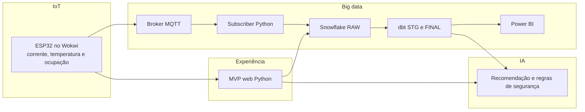

# Wattly — Planejamento da solução

Produto digital de credenciamento, indicação geográfica, reserva, pagamento e avaliação de pontos de recarga elétrica entre cidadãos. Este documento organiza o produto e a entrega da **Global Solution 2026/2 — CitizenTech** (FIAP, Engenharia de Software On, turma 4ESOA).

**Prazo:** 19/11/2026, até 23h55, na plataforma. Uma entrega por grupo. Sem prorrogação.

**Nome do produto:** Wattly. O mesmo nome entra no repositório, no PDF, no `.txt` e no pitch.

---

## 1. O que a entrega precisa conter

O enunciado pede um `.zip` com três itens. Faltar qualquer um deles custa 1 ponto.

| Item | Conteúdo |
| --- | --- |
| Código | Projeto organizado por área, com README que ensina a executar cada parte. |
| PDF | A solução, a arquitetura, os prompts ou regras, os prints da IA e do dashboard, e a evidência de Docker, CI/CD ou monitoramento. |
| `.txt` | Nome do grupo, RM e nome de cada integrante, e o link público do vídeo pitch. |

A nota vale **20 pontos**: 15 do projeto e 5 do vídeo.

| Bloco | Pontos | O que precisa existir |
| --- | --- | --- |
| IA e automação | 4 | Função de IA aplicada ao problema, prompts ou regras documentados, exemplo de entrada e saída, e uma métrica de antes e depois. |
| Big data e visualização | 4 | Modelo ou camadas de dados, caminho da coleta ao dado tratado, dashboard com 3 ou mais indicadores e filtros, e medidas analíticas (DAX). |
| MVP, IoT e experiência digital | 4 | 4 ou mais telas funcionais, 2 ou mais sensores, um uso completo do início ao fim, e o diagrama da arquitetura. |
| DevOps, segurança e qualidade | 3 | Pastas por módulo e Git, Docker ou CI/CD ou monitoramento, 2 ou mais práticas de segurança, plano com 5 ou mais testes e a evidência da execução. |
| Vídeo pitch | 5 | Até 3 minutos, link público, protótipo funcionando. Problema, demonstração, impacto e clareza. |

As quatro áreas resolvem o **mesmo problema**. Integrar uma área à outra é diferencial de premiação, e a nota de cada área depende de ela rodar seguindo só o README. Tecnologia que não tenha sido vista até a fase 7 não pontua naquela área.

Stack deste planejamento, alinhada ao que o grupo já entregou na fase anterior e ao que o enunciado nomeia:

- API de credenciamento em **Rust** com **Actix Web** e banco **Oracle**
- Sensores no **ESP32 simulado no Wokwi**, com publicação **MQTT**
- Lago de dados no **Snowflake**, tratamento com **dbt**, visualização no **Power BI** com **DAX**
- Empacotamento com **Docker** e pipeline de CI com a ferramenta vista em aula (**GitHub Actions ou Jenkins**)
- Versionamento com **Git**

O mapa pode usar Leaflet com OpenStreetMap. Se essa biblioteca não entrou no conteúdo da fase, a indicação geográfica fica numa lista ordenada por distância, que continua cumprindo o fluxo.

---

## 2. Cidadão e problema

O cidadão principal é o **motorista de carro elétrico que não tem um carregador exclusivo**. Em geral mora em prédio, divide vaga, ou está fora do bairro onde poderia carregar em casa. O segundo cidadão é o **morador que já tem uma tomada, uma garagem ou um wallbox ocioso** e pode oferecer essa energia por um período.

O problema concreto é a falta de pontos de recarga distribuídos, visíveis e confiáveis. O carro elétrico avança mais rápido do que a rede pública de abastecimento. Quem dirige perde tempo procurando um ponto, chega e encontra o conector errado, a vaga ocupada ou o equipamento fora do ar. Quem poderia oferecer a tomada da própria casa não tem um canal simples para se credenciar, ser encontrado e receber pelo uso.

A melhoria que o Wattly entrega é esta: em poucos minutos o motorista vê pontos próximos, com preço, conector, nota e disponibilidade, reserva um horário, paga pelo aplicativo e avalia a experiência. O anfitrião se credencia, define quando a vaga está livre e quanto cobra, e recebe a maior parte do valor. A plataforma fica com uma taxa pequena.

Dado para abrir o pitch, a confirmar na fonte oficial antes de gravar: a ABVE divulgou **177.358 veículos leves eletrificados emplacados no Brasil em 2024** ([abve.org.br](https://abve.org.br)). A frase do vídeo só entra com o número conferido no site da ABVE no dia da gravação. A leitura é direta: a frota cresce, e a recarga perto de onde as pessoas moram e trabalham continua sendo o gargalo.

---

## 3. Proposta de valor

O Wattly é um marketplace de recarga, no mesmo desenho de uma plataforma de duas pontas.

1. Qualquer pessoa com um ponto de energia se credencia e ganha um perfil público, com nota.
2. O ponto aparece no mapa, com preço, tipo de conector, potência declarada e horários.
3. O motorista reserva por minutos ou por horas e paga no aplicativo.
4. Os dois lados se avaliam depois da sessão.
5. Do valor pago, uma parte fica com a plataforma e a outra vai para quem forneceu a energia.

### Regras de negócio do MVP

| Regra | Valor adotado no protótipo |
| --- | --- |
| Preço | O anfitrião define preço por minuto e por hora. A sessão usa o preço do modo escolhido na reserva. |
| Cobrança | Valor = preço × tempo real da sessão. Tempo mínimo de 15 minutos. |
| Taxa da plataforma | 12% do valor bruto. 88% vai para o anfitrião. |
| Pagamento no MVP | PIX simulado, com status `pendente`, `pago` e `estornado`. Sem número de cartão e sem integração bancária real. |
| Endereço | O mapa mostra bairro e um ponto aproximado. O endereço completo só aparece depois da reserva paga. |
| Avaliação | Nota de 1 a 5, nos dois sentidos, somente depois de uma sessão concluída. |
| Sessão válida | A sessão só conclui se o sensor de corrente indicar consumo acima do limiar. Isso evita cobrar uma recarga que não aconteceu. |
| Segurança do ponto | Temperatura do plugue acima de 60 °C gera alerta e a IA tira o ponto da recomendação até normalizar. |

A taxa de 12% é uma escolha de protótipo para a conta fechar de forma visível na tela e no dashboard. O percentual pode ser ajustado no código, num único lugar, para o PDF mostrar a fórmula.

### Exemplo de transação

Reserva de 1 hora a R$ 0,40 por minuto.

- Tempo cobrado: 60 minutos
- Valor bruto: R$ 24,00
- Plataforma (12%): R$ 2,88
- Anfitrião (88%): R$ 21,12
- O motorista vê também o kWh medido pelo sensor, para conferir se a energia foi de fato entregue. No MVP o preço é por tempo, como pedido no modelo de negócio. O kWh é transparência, e a base para um preço por energia numa versão seguinte.

---

## 4. Quem participa

| Participante | Papel no Wattly |
| --- | --- |
| Motorista | Busca, reserva, paga, carrega e avalia. |
| Anfitrião | Credencia o ponto, publica horários e preço, acompanha a sessão e recebe. Uma pessoa pode ter os dois papéis. |
| Plataforma | Credencia, indica no mapa, processa a reserva, divide o pagamento e publica a reputação. |
| Ponto de recarga (IoT) | Mede corrente e temperatura e informa se a vaga está em uso. |
| Operação da plataforma | Olha o dashboard para decidir onde há demanda sem oferta e quais pontos estão inseguros ou ociosos. |

Fora do MVP, e citado no ecossistema do PDF e do pitch: distribuidora de energia, condomínio e prefeitura. Eles não têm tela nesta entrega. O desenho deixa um lugar para eles: o dashboard já separa os indicadores por bairro, que é a visão que uma cidade usaria para enxergar buracos de infraestrutura.

---

## 5. Jornadas

### 5.1 Credenciamento do anfitrião

1. Cria a conta e informa nome, e-mail e senha.
2. Cadastra o ponto: apelido, bairro, coordenadas, tipo de conector (`tomada_220v` ou `wallbox`), potência declarada em kW, preço por minuto, preço por hora e uma faixa de horários.
3. O status nasce `pendente`.
4. O teste de credenciamento pede uma leitura do sensor. Se a corrente e a temperatura chegam pelo MQTT, o ponto passa para `aprovado` e entra no mapa.
5. O perfil público mostra a nota média, o número de sessões concluídas e o tipo de conector.

### 5.2 Uso do motorista, do início ao fim

Este é o fluxo que a área de MVP precisa demonstrar inteiro.

1. Entra na conta.
2. Informa onde está, o conector do carro, a bateria atual e quanto tempo tem.
3. Vê os pontos no mapa ou na lista, com distância, preço, nota e disponibilidade.
4. Abre o detalhe de um ponto. A IA mostra as três melhores opções e o motivo de cada uma.
5. Escolhe minutos ou horas, confirma a reserva e paga com o PIX simulado.
6. O endereço completo é liberado.
7. No local, a sessão começa. A tela mostra tempo, valor parcial, corrente, temperatura e kWh.
8. A sessão encerra. A tela mostra o valor bruto, a taxa e o valor do anfitrião.
9. Motorista e anfitrião se avaliam. A nota média dos dois perfis é recalculada.

### 5.3 O que o anfitrião acompanha

- Horários em que o ponto está aberto
- Sessão em andamento e alerta de temperatura
- Ganhos do período
- Notas recebidas

---

## 6. Como a solução responde ao enunciado

| Pergunta do enunciado | Resposta do Wattly |
| --- | --- |
| Quem é o cidadão | Motorista sem carregador próprio e morador que oferece o ponto ocioso. |
| Qual problema | Encontrar e confiar numa recarga perto de casa, do trabalho ou da rota, e transformar tomada parada em renda. |
| Como funciona | Credenciamento, mapa, reserva por tempo, pagamento com divisão automática, sessão medida por sensor e avaliação dos dois lados. |
| Quais tecnologias | Python, ESP32/Wokwi, MQTT, Snowflake, dbt, Power BI, Docker, Git e a IA descrita na seção 8. |
| Quem participa | Motorista, anfitrião, plataforma, sensor e a operação que lê o dashboard. |
| Como o impacto é medido | Tempo até achar um ponto compatível, taxa de sessões concluídas com energia de fato entregue, kWh fornecidos pela rede cidadã e nota média dos pontos. |

A solução permanece útil com conectividade ruim. O ESP32 aplica a regra de temperatura na borda, sem esperar a nuvem. O aplicativo guarda a última situação conhecida do ponto e ainda permite reservar, marcada como `a confirmar no local`, quando o MQTT está fora.

Inclusão e acesso no MVP:

- Texto curto nas telas, rótulos visíveis e contraste alto.
- O conector `tomada_220v` existe de propósito. A maioria das casas não tem wallbox, e excluir a tomada comum deixaria de fora o cidadão que o produto quer credenciar.
- O endereço exato fica oculto até a reserva paga, para reduzir exposição de quem oferece a própria casa.
- O pagamento simulado não pede dado financeiro real.

---

## 7. ODS

O enunciado pede os ODS da lista da disciplina e a forma como o projeto contribui.

| ODS | Contribuição do Wattly |
| --- | --- |
| 11 — Cidades e comunidades sustentáveis | Aumenta a infraestrutura de recarga usando garagens e tomadas que já existem, e mostra no mapa onde a oferta cidadã cobre ou deixa de cobrir a cidade. |
| 13 — Ação contra a mudança do clima | Reduz a barreira prática para usar o carro elétrico no lugar do abastecimento fóssil. O kWh entregue pela rede cidadã é o indicador dessa contribuição. |
| 9 — Indústria, inovação e infraestrutura | Trata a casa do cidadão como infraestrutura distribuída, com credenciamento, sensor e reputação, no lugar de depender só de grandes eletropostos. |
| 10 — Redução das desigualdades | Quem mora em prédio sem vaga eletrificada passa a ter onde carregar. Quem tem uma tomada ociosa passa a ter uma renda pequena e formalizada pela plataforma. |

---

## 8. Arquitetura

As áreas podem ser demonstradas em separado. O caminho integrado, que pesa na premiação, é o seguinte.



| Componente | Área | Tecnologia | Função |
| --- | --- | --- | --- |
| API de credenciamento | DevOps e MVP | Rust, Actix Web e Oracle | Contas, dossiê do anfitrião, ponto geográfico, documentos, revisão e mapa público. |
| Testes da API | DevOps | Repositório em memória | A esteira roda o fluxo sem a rede da FIAP. O servidor publicado usa o Oracle. |
| Estação simulada | IoT | ESP32 no Wokwi | Lê os sensores, aplica a regra de temperatura e publica JSON. |
| Broker | IoT e dados | MQTT (HiveMQ público, como na fase anterior) | Leva a leitura do ESP32 até o subscriber. |
| Subscriber | Big data | Python | Grava `.jsonl`, envia à stage e faz o `COPY INTO`. |
| Lago | Big data | Snowflake, camadas RAW, STG e FINAL | Guarda o bruto e o tratado. |
| Transformação | Big data | dbt | Tipa o JSON e monta fatos e dimensões. |
| Dashboard | Big data | Power BI + DAX | Indicadores com filtros para a operação e para o anfitrião. |
| Recomendação | IA | Python, modelo treinado em dados simulados | Ordena os pontos e explica a escolha. |
| Execução | DevOps | Docker, Git e CI | Sobe a API e roda os testes a cada commit. |

A API publicada grava o credenciamento no Oracle da FIAP. Os testes automatizados usam um repositório em memória, então a esteira não depende da rede da escola nem da senha. Os eventos de sessão e de leitura, quando a área de dados entrar, seguem para o lago. A IA, no modo integrado, lê a camada FINAL (nota, taxa de conclusão, temperatura). No modo isolado, lê um CSV de exemplo versionado.

---

## 9. Área 1 — IA e automação (4 pontos)

### 9.1 O que a IA resolve

A IA escolhe o ponto de recarga com mais chance de uma sessão boa para aquele motorista. Uma sessão boa, neste protótipo, é uma sessão concluída, com conector compatível, ponto disponível, temperatura segura e histórico de nota alta.

Sem a IA, o comportamento de referência é abrir o ponto mais próximo. Esse atalho erra quando o conector não serve, o ponto está fechado ou o plugue está quente.

### 9.2 Modelo

Treino supervisionado em Python, com dados simulados versionados em `dados/ia/`.

- **Alvo:** `sessao_satisfatoria` (1 ou 0).
- **Entradas:** distância em km, preço por minuto, nota média, conector compatível, disponível agora, temperatura abaixo de 60 °C, taxa histórica de sessões concluídas.
- **Algoritmo:** o modelo de classificação visto em aula. Se a fase usou mais de um, ficar com o que o grupo sabe explicar. Regressão logística já basta para demonstrar, treinar rápido e mostrar coeficiente.
- **Saída para o usuário:** as três estações com maior probabilidade, entre as compatíveis e disponíveis, com uma frase curta dizendo o motivo (mais perto, mais barata, melhor nota, plugue em temperatura segura).

Conjunto de demonstração sugerido: 300 sessões simuladas, 70% treino e 30% teste, com semente fixa para o resultado se repetir na correção.

### 9.3 Regras de automação no sensor

Documentar no PDF estas regras, que rodam no ESP32 a cada leitura:

| Condição | Ação |
| --- | --- |
| Corrente acima de 0,5 A | Sessão marcada como `entregando_energia`. |
| Corrente em ou abaixo de 0,5 A durante a sessão | Sessão permanece `sem_consumo`. Não pode ser concluída como recarga válida. |
| Temperatura acima de 60 °C | Alerta `plugue_quente`. O ponto sai das recomendações. |
| Temperatura de volta a 50 °C ou menos | Alerta encerrado. O ponto volta a poder ser recomendado. |

### 9.4 Prompt

Se a fase tiver incluído agente ou modelo de linguagem, o texto abaixo é o prompt usado para transformar o ranking num parágrafo que o motorista lê. Ele entra no PDF junto com um exemplo real de entrada e saída. Se agente de linguagem não fez parte do conteúdo, a frase de explicação sai de um template em Python preenchido com as features, e o PDF documenta essa automação no lugar do prompt. As duas formas atendem o item "prompts, agentes ou regras".

```text
Você recomenda pontos de recarga do Wattly.
Use somente a lista de estações recebida em JSON. Não invente ponto, preço ou nota.
Considere o conector do carro, o tempo disponível e o preço máximo.
Ordene por chance de uma sessão concluída e segura.
Devolva no máximo 3 opções. Para cada uma, informe id, nome, preço por minuto,
tempo estimado e uma justificativa de até 20 palavras.
Se nenhuma estação servir, diga isso e não sugira alternativa fora da lista.
```

### 9.5 Exemplo para o PDF

Entrada:

```json
{
  "bairro": "Vila Mariana",
  "conector": "tomada_220v",
  "bateria_pct": 28,
  "minutos_disponiveis": 90,
  "preco_max_minuto": 0.5
}
```

Saída esperada, com números reais da execução colados no PDF:

```json
{
  "recomendacoes": [
    {
      "id": "est-014",
      "nome": "Garagem da Ana",
      "preco_minuto": 0.35,
      "probabilidade": 0.86,
      "motivo": "Conector compatível, nota 4,8 e plugue em 32 °C."
    }
  ]
}
```

### 9.6 Métrica de antes e depois

Comparar, no conjunto de teste, duas políticas:

- **Antes:** indicar a estação compatível mais próxima, sem olhar nota, disponibilidade e temperatura.
- **Depois:** indicar a estação com maior probabilidade prevista pelo modelo, entre as compatíveis, disponíveis e com temperatura segura.

Métrica principal: **taxa de recomendação útil**, a fração de casos de teste em que a estação indicada teria sessão satisfatória. Métrica complementar: quantos casos a política de “mais próxima” escolhe um ponto quente ou indisponível, e quantos a IA evita.

O PDF leva a tabela com os dois percentuais medidos na execução, um print do treino e um print da tela do motorista com a recomendação. A meta do experimento é a IA ficar acima da política de proximidade. O número publicado é o número medido, qualquer que seja.

Como a funcionalidade será demonstrada: o README da pasta de IA traz um comando único que treina, imprime as métricas e classifica o exemplo da seção 9.5. A mesma recomendação aparece na tela de mapa do MVP.

---

## 10. Área 2 — Big data e visualização (4 pontos)

### 10.1 Camadas

| Camada | Onde | O que guarda |
| --- | --- | --- |
| RAW | `RAW.LEITURAS_PONTO`, `RAW.EVENTOS_SESSAO`, `RAW.AVALIACOES` | JSON bruto, como chegou do MQTT e da aplicação. |
| STG | modelos dbt | Colunas tipadas, horários em UTC-3, ids válidos, duplicata de leitura removida. |
| FINAL | modelos dbt | Fatos e dimensões prontos para o Power BI e para a IA. |

Dimensões: `dim_estacao`, `dim_usuario`, `dim_tempo`.

Fatos: `fct_leituras`, `fct_sessoes`, `fct_avaliacoes`, `fct_transacoes`.

Campos mínimos de `fct_sessoes`: estação, motorista, início, fim, minutos, kWh, valor bruto, taxa da plataforma, valor do anfitrião, status, alerta de temperatura.

Um CSV da camada FINAL vai versionado em `dados/final/`. O Power BI do repositório abre em cima desse CSV, para o dashboard funcionar na correção sem login no Snowflake. O README descreve também o caminho completo, com stage e `COPY INTO`, para quem tiver a credencial.

### 10.2 Caminho dos dados

1. O ESP32 publica, a cada poucos segundos, um JSON com `estacao_id`, corrente, temperatura, ocupação e o alerta já calculado na borda.
2. O subscriber acumula as mensagens em `.jsonl`, registra a execução em log e carrega o arquivo na stage.
3. O `COPY INTO` grava o bruto em RAW.
4. O dbt monta STG e FINAL.
5. A aplicação exporta reservas, pagamentos e avaliações no mesmo formato, e eles entram por um segundo arquivo `.jsonl`, para o dashboard mostrar dinheiro e nota junto com o sensor.
6. O Power BI lê a FINAL.

Enquanto o MQTT de demonstração não estiver no ar, o README aceita um `.jsonl` de exemplo já commitado. Assim a ingestão tem as duas evidências: uma execução ao vivo, se der, e uma execução reproduzível com arquivo local.

### 10.3 Dashboard

Público da tela: a operação da plataforma, decidindo onde a rede cidadã está saudável e onde o motorista fica sem opção. O anfitrião usa o mesmo arquivo filtrado pela própria estação.

Filtros obrigatórios: período, bairro e tipo de conector.

Indicadores, todos com decisão associada:

| Indicador | Decisão que ele apoia |
| --- | --- |
| Sessões concluídas e kWh entregues | O bairro está de fato abastecendo carros ou só tem cadastro parado? |
| Valor do anfitrião e taxa da plataforma | A oferta cidadã está gerando renda e a taxa está coerente com o uso? |
| Nota média e percentual de sessões com alerta de temperatura | Qual ponto precisa de visita, suspensão ou orientação de segurança? |
| Reservas recusadas por falta de ponto disponível | Em qual bairro vale credenciar mais anfitriões? |

Três indicadores já cumprem a rubrica. O quarto fica porque responde à pergunta de crescimento da rede.

### 10.4 Medidas DAX

Documentar no PDF, com print do painel de medidas:

- `KWh Entregues = SUM(fct_sessoes[kwh])`
- `Taxa Plataforma = SUM(fct_sessoes[taxa_plataforma])`
- `Valor Anfitriao = SUM(fct_sessoes[valor_anfitriao])`
- `Nota Media = AVERAGE(fct_avaliacoes[nota])`
- `Pct Alerta Temperatura = DIVIDE(COUNTROWS(FILTER(fct_sessoes, fct_sessoes[alerta_temperatura] = TRUE())), COUNTROWS(fct_sessoes))`
- `Minutos Medios = AVERAGE(fct_sessoes[minutos])`

O print do dashboard com um filtro aplicado (um bairro só, por exemplo) entra no PDF. Sem esse print o item de dashboard fica fraco na correção.

---

## 11. Área 3 — MVP, IoT e experiência (4 pontos)

### 11.1 Telas

Seis telas, acima do mínimo de quatro. Todas com dados de exemplo para o fluxo completar sem cadastro externo.

| # | Tela | Quem usa | O que faz |
| --- | --- | --- | --- |
| 1 | Entrar e criar conta | Os dois | Autentica e separa o papel motorista ou anfitrião. |
| 2 | Mapa ou lista de pontos | Motorista | Mostra distância, preço, nota, conector e a recomendação da IA. |
| 3 | Detalhe, reserva e pagamento | Motorista | Escolhe minutos ou horas, mostra o total, simula o PIX e libera o endereço. |
| 4 | Sessão em andamento | Os dois | Tempo, valor parcial, corrente, temperatura, kWh e encerramento. |
| 5 | Avaliações | Os dois | Nota de 1 a 5 depois da sessão, e a média do perfil. |
| 6 | Credenciamento e ganhos | Anfitrião | Cadastro do ponto, horários, teste do sensor e extrato. |

### 11.2 Sensores

Dois sensores obrigatórios e um terceiro de contexto, no ESP32 do Wokwi:

| Sensor | Grandeza | Uso |
| --- | --- | --- |
| ACS712, ou potenciômetro nomeado como corrente no mock | Corrente em ampere | Prova de que houve entrega de energia. Limiar de 0,5 A. |
| DHT22 ou sensor de temperatura do Wokwi | Temperatura do plugue em °C | Segurança. Alerta acima de 60 °C. |
| Botão ou sensor de presença, se couber no tempo | Vaga ocupada | Mostra no mapa se o ponto está livre. É reforço, a rubrica já fecha com os dois primeiros. |

O circuito e o firmware seguem o padrão já usado pelo grupo: o ESP32 publica um JSON no MQTT com a leitura e o alerta calculado no próprio dispositivo. O print do Wokwi entra no PDF.

JSON publicado:

```json
{
  "estacao_id": "est-014",
  "corrente_a": 8.4,
  "temperatura_c": 41.2,
  "ocupada": true,
  "alerta": null,
  "ts": "2026-11-18T14:05:00-03:00"
}
```

### 11.3 Arquitetura no PDF

O diagrama da seção 8 vai para o PDF, com uma frase para cada seta: o que trafega e em que formato. A rubrica pede o desenho geral e como as áreas se conectam.

---

## 12. Área 4 — DevOps, segurança e qualidade (3 pontos)

Esta área está implementada na API em `api/`. O passo a passo de execução, o Docker e a esteira estão no `README.md`.

### 12.1 Organização

```text
Wattly/
  README.md
  Dockerfile
  docker-compose.yml
  .github/workflows/ci.yml
  api/                 Actix Web, módulos de domínio, Oracle, testes
  planejamento.md
```

O projeto é versionado com Git. O arquivo `api/.env` fica de fora do repositório.

### 12.2 Docker e CI

- `Dockerfile` gera a imagem com o binário e o Oracle Instant Client.
- `docker compose up --build` sobe a API lendo `api/.env`.
- `.github/workflows/ci.yml` formata, roda o clippy, executa `cargo test`, compila o release, audita as dependências e constrói a imagem sem publicá-la.
- Evidência no PDF: print do container no ar e print da execução verde no GitHub Actions.

### 12.3 Segurança

1. **Autenticação.** Senha com Argon2id. O acesso seguinte usa JWT, e cada rota protegida relê o status da conta.
2. **Validação de entrada.** CPF, CNPJ, preço, coordenada, conector e horário são recusados quando inválidos. A transição de status do credenciamento também é recusada fora da sequência permitida.
3. **Proteção de dados.** O mapa público devolve coordenada arredondada e não devolve endereço, instrução de acesso nem documento completo. Senha e segredo do banco não entram em log.

### 12.4 Plano de testes

A evidência é a saída do `cargo test`. Os casos abaixo passam na suíte atual.

| Caso | O que prova |
| --- | --- |
| `health_responde_ok` | A API responde. |
| `cadastro_rejeita_cpf_invalido_e_senha_fraca` | Validação de entrada. |
| `cadastro_conflita_quando_o_email_se_repete` | Unicidade e máscara do CPF. |
| `login_rejeita_senha_errada` | Autenticação. |
| `fluxo_de_credenciamento_aprova_e_esconde_o_endereco` | Dossiê, checklist, transição inválida e privacidade geográfica. |
| `usuario_suspenso_nao_entra` | Conta suspensa perde o acesso. |
| Testes de domínio | CPF, CNPJ, preço, transição de status, distância e máscaras. |

---

## 13. Diferenciais de premiação

Estes itens não somam ponto na nota e pesam no desempate.

| Diferencial | Como o Wattly chega lá |
| --- | --- |
| Áreas integradas | A leitura do ESP32 alimenta a sessão na tela, o fato no dashboard e o corte de recomendação quando o plugue esquenta. A IA usa nota e taxa de conclusão da camada FINAL. |
| Pipeline de ponta a ponta | O push dispara instalação, testes e a checagem de que a aplicação sobe. |
| IA medida | A taxa de recomendação útil fica registrada, contra a política de escolher o ponto mais próximo. |
| Conversa com gente real | Antes de gravar, duas conversas curtas: um motorista de elétrico, ou alguém que já cogitou comprar, e um morador que toparia emprestar a vaga. O vídeo cita uma frase do que mudou no protótipo por causa disso. Se ninguém for encontrado até 18/11, o pitch não inventa entrevista. |

---

## 14. Vídeo pitch (5 pontos)

Regras que zeram ou cortam nota: passar de 3 minutos, link privado ou quebrado, vídeo de slides ou de leitura de texto na tela. O link fica no `.txt` e no README, testado numa janela anônima.

| Tempo | Bloco | O que mostrar |
| --- | --- | --- |
| 0:00–0:30 | Problema | O motorista sem carregador em casa e o morador com a tomada parada. O dado da ABVE, conferido no dia. |
| 0:30–0:50 | Solução | Credenciar, achar no mapa, pagar por tempo, dividir o valor e avaliar dos dois lados. |
| 0:50–2:10 | Demonstração | Na aplicação: reserva, PIX simulado e sessão. Na IA: a recomendação com o motivo. No Power BI: um filtro de bairro e o kWh. No Wokwi: a corrente subindo e, em seguida, a temperatura passando de 60 °C e o alerta aparecendo. |
| 2:10–2:40 | Impacto | Quem ganha e os ODS 11, 13, 9 e 10, numa frase cada. |
| 2:40–3:00 | Fechamento | Por que esta rede cidadã aumenta a recarga sem esperar um eletroposto novo em cada esquina. |

O vídeo mostra o site e o sensor funcionando. O roteiro fica na mão de quem fala, fora da tela.

---

## 15. O que vai no PDF da entrega

Sugestão de ordem, para o avaliador achar cada item da rubrica:

1. Capa com nome do grupo, integrantes, RMs e nome do produto.
2. Cidadão, problema, jornada e modelo de negócio, inclusive a conta da taxa.
3. ODS.
4. Diagrama de arquitetura.
5. IA: regras, prompt ou template, print da entrada e da saída, tabela antes e depois.
6. Big data: camadas, caminho da ingestão, print do dashboard com filtro, lista de medidas DAX.
7. MVP: print das telas do fluxo completo e print do Wokwi com os sensores.
8. DevOps: print do Docker e do pipeline, práticas de segurança, tabela de testes e saída do `cargo test`.
9. Declaração das ferramentas de IA generativa usadas, e para quê.

---

## 16. Divisão e calendário

Entrega em 19/11. O calendário abaixo cabe em cinco pessoas. Quem estiver em menos gente junta as colunas vizinhas.

| Pessoa | Frente | Pronto quando |
| --- | --- | --- |
| A | MVP: contas, reserva, pagamento simulado, sessão e avaliações | Dá para fazer a jornada da seção 5.2 num navegador |
| B | IoT: circuito no Wokwi, JSON e regras de corrente e temperatura | O alerta de 60 °C aparece numa leitura publicada |
| C | IA: dados simulados, treino, métrica e recomendação na tela | O comando do README imprime o antes e depois e o exemplo |
| D | Big data: ingestão, dbt, CSV final e Power BI com DAX | O `.pbix` abre no CSV e filtra por bairro |
| E | Docker, CI, testes, README, PDF e apoio ao vídeo | `cargo test` verde no pipeline e rascunho do PDF com os prints |

| Dia | Meta |
| --- | --- |
| 14/11 | Este planejamento fechado, repositório criado, modelo de dados e usuários de demonstração. |
| 15/11 | Telas 1 a 4 funcionando com dados fixos. Circuito do Wokwi publicando. |
| 16/11 | Sessão ligada à leitura de corrente. Ingestão gravando `.jsonl`. Primeiro treino da IA. |
| 17/11 | Avaliações, divisão da taxa, dashboard com os quatro indicadores, testes T1 a T8. |
| 18/11 | Docker, pipeline, PDF com prints, ensaio do vídeo. |
| 19/11 | Gravar, testar o link anônimo, montar o zip e o `.txt`, enviar até 23h55. |

### `.txt` da entrega

Um arquivo de texto puro, com o nome do grupo, uma linha por integrante no formato `RM - Nome Completo`, e o link do vídeo. Todos os integrantes do grupo entram nesse arquivo. Confirmar a lista antes de zipar. Referência do grupo das fases anteriores, a validar com o time:

| Nome | RM |
| --- | --- |
| Henrique Parra | RM551973 |
| Guilherme Barreto | RM97674 |
| Roberto Oliveira | RM551460 |
| Nicolas Oliveira | RM98939 |
| Marcos Vinicius | RM99894 |

---

## 17. Declaração de IA generativa

O enunciado permite IA para pesquisa, revisão de texto e explicação de erros. Não permite entregar código ou texto gerado sem entender e sem revisar. O README e o PDF levam uma seção curta neste formato:

- Ferramenta:
- Onde foi usada:
- O que o grupo reviu e alterou:

Este planejamento foi redigido com apoio de IA generativa no Cursor, a partir do enunciado `4ESOA - Global Solution 2026-2` e da descrição do produto. O grupo revisa o texto, troca o que não representar a solução que for de fato construída e mantém a declaração na entrega final.

---

## 18. Checklist antes de enviar

- Cada área roda seguindo somente o README, inclusive a IA e o dashboard a partir dos arquivos de exemplo.
- O PDF tem a solução, a arquitetura e a evidência de cada área.
- Os prints do dashboard filtrado e da IA com entrada e saída estão no PDF.
- O print do Docker ou do pipeline está no PDF.
- O `.txt` tem o grupo, os RMs, os nomes e o link do pitch.
- O link do vídeo abre numa janela anônima e o vídeo tem até 3 minutos, com o protótipo na tela.
- O zip foi enviado na plataforma até 19/11/2026, 23h55.

Itens que tiram ponto e o grupo evita: README ausente, tecnologia de uma área que ninguém sabe explicar porque não foi vista na fase, área que só funciona na máquina de quem desenvolveu, pitch privado, e material de outro projeto sem crédito.
